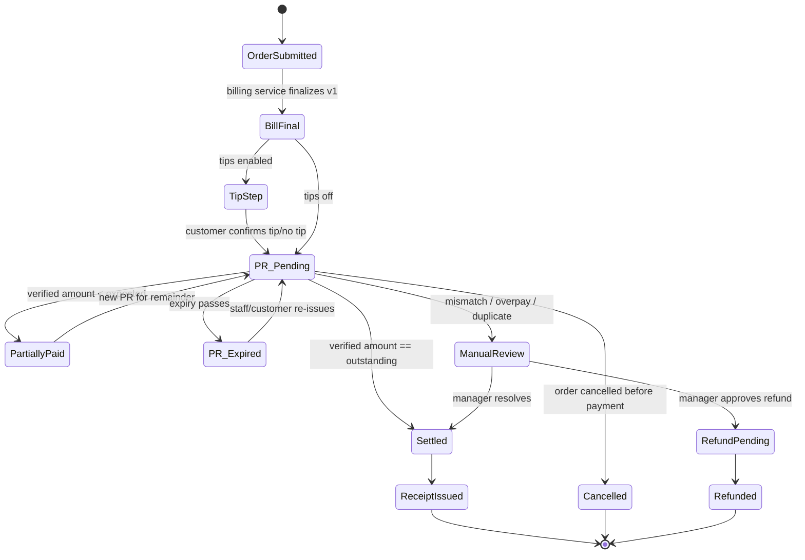
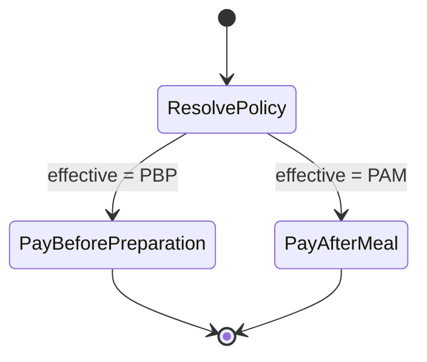

**Draft.**

> **ADR alignment.** Where this draft disagreed with ADR 0009 or ADR 0010, the ADR wording is kept. Conflicts:
> 1. Finance D1 ordered policy as outlet+order-type, then outlet default, then org+order-type, then org default. ADR 0009 precedence is order override, then table or session, then channel, then outlet, then organization, then default. Kitchen release stays a separate policy.
> 2. The drafts omitted the ADR 0009 channel defaults: dine-in is PAY_AFTER_MEAL; takeaway and delivery are PAY_BEFORE_PREPARATION. Kitchen release: dine-in on order; prepay channels on verified payment of the bill total excluding tip. A tip never blocks the kitchen.
> 3. The drafts omitted who may create a partial instalment. ADR 0009: Cashier, Manager, or Admin. A captain can only display or share an existing request. Refunds and MANUAL_REVIEW stay Manager or Admin only.
> 4. ADR 0010 sets a default tip cap of 25% of the post-discount, pre-tax subtotal. It is configurable. The drafts did not state that cap.
> 5. BILL_GENERATION_WORKFLOW said a tip change keeps the same bill version. ADR 0010: adding, changing, or removing a tip increments billVersion.

# Payment Workflows: Bill → Payment Request → Payment → Receipt
> **DRAFT — Finance Manager, 2026-11-07, pending Founder/CEO review.**
> Sources: `FOUNDER_ORDER_2026-11-07.md` (this folder); `../TRONX_PRO_MAX_TASK_BOARD.md`; `/workspace/tronx-hq/projects/tasks.csv`. `PROVIDER_CAPABILITY_RESEARCH.md` did **not exist** at time of writing, so every provider fee, settlement timeline, capability, and report format below is **TBD**. The amounts are INR. Bill arithmetic belongs to `calculateRestaurantBill` (`lib/billing/calculate-bill.ts`). It exists in the ROS repo but not on the box, and Backend will supply its outputs. This doc defines no tax rules of its own. Provider facts remain TBD until PROVIDER_CAPABILITY_RESEARCH.md arrives from the CEO.

## 1. Separate objects (per Founder order 2)
| Object | Key fields | Status values |
|---|---|---|
| Order | orgId, outletId, orderId, orderType | (existing) |
| Bill (versioned) | billId, version, snapshot from `calculateRestaurantBill`, payableAmount, tipAmount | RUNNING → FINAL → SETTLED / PARTIALLY_PAID / VOID |
| PaymentRequest (PR) | prId, billId+version, merchantAccountId, expectedAmount, currency=INR, expiry, providerRef, reason, supersededBy | CREATED, ACTIVE, PAID, SUPERSEDED, EXPIRED, CANCELLED, MANUAL_REVIEW, REFUNDED |
| Payment (collection) | paymentId, prId, providerPaymentRef, amount, method, verifiedVia (webhook-signature / status-check) | VERIFIED, FAILED, REFUND_PENDING, REFUNDED, MANUAL_REVIEW |
| Receipt | receiptId, billId+version, payments[] | ISSUED |

\*PARTIALLY_PAID sits on the **Bill**. A PR is single-amount: either it is paid in full, or it closes and a new PR is issued for the remainder (§4).

The Wave 1 payment ledger is the source of truth. Payment status changes only on a signature-verified webhook or an authenticated provider status check, and the handler is idempotent on providerPaymentRef. Front-end amounts are never trusted.

## 2. Common guards (all modes)
- G1: A PR is created only from a FINAL bill version, and the amount comes from the server-side bill (+ confirmed tip).
- G2: A PR is bound to one bill version and one merchant account and is never reused.
- G3: If the bill version changes, the open PR becomes SUPERSEDED, with a reason and supersededBy pointing at the replacement request. It is not CANCELLED. EXPIRED is only for time running out on an unchanged bill.
- G4: The verification check must match merchant, providerRef, prId/orderRef, amount, currency and status. Any mismatch goes to MANUAL_REVIEW (§5).
- G5: The receipt and the WhatsApp confirmation are sent only after the Bill reaches SETTLED.
- G6: Exact-amount enforcement by the provider is **TBD** (PROVIDER_CAPABILITY_RESEARCH.md). Until it is confirmed, assume the payer can send any amount.
- G7: Captains cannot refund, settle or cash-close by default.

## 3. Modes
### 3.1 PAY_BEFORE_PREPARATION
Trigger for the bill: order submission. Kitchen release is a **separate policy** and is not forced by payment (Founder order).

If the order is cancelled after a verified payment, the case goes to REFUND_PENDING, which needs a manager role. The kitchen-release policy then reads Bill status as an input only.

### 3.2 PAY_AFTER_MEAL
A table session holds multiple orders and one running bill. Bill-timing triggers: customer request, captain, or checkout.
```mermaid
stateDiagram-v2
  [*] --> SessionOpen
  SessionOpen --> RunningBill: orders added (snapshots kept)
  RunningBill --> RunningBill: more orders / cancels (new snapshot)
  RunningBill --> BillFinal: bill requested (customer/captain/checkout)
  BillFinal --> RunningBill: items added after final (version++, old PR superseded)
  BillFinal --> TipStep: tips enabled
  TipStep --> PR_Pending
  BillFinal --> PR_Pending: tips off
  PR_Pending --> PartiallyPaid
  PartiallyPaid --> PR_Pending: remainder PR
  PR_Pending --> Settled
  PR_Pending --> PR_Expired
  PR_Expired --> PR_Pending
  PR_Pending --> ManualReview
  Settled --> ReceiptIssued --> SessionClosed
  SessionClosed --> [*]
```
The bill cannot close while any of its PaymentRequests is MANUAL_REVIEW, or ACTIVE and unexpired (ADR 0008, PD-1 confirmed).

### 3.3 FLEXIBLE
The effective policy (3.1 or 3.2) is resolved per order and stamped on the order at creation, so later setting changes don't affect open orders. Precedence, per ADR 0009 (CEO default, configurable, pending Founder confirmation): order override, then table or session, then channel, then outlet, then organization, then default. Dine-in is PAY_AFTER_MEAL. Takeaway and delivery are PAY_BEFORE_PREPARATION. Kitchen release is separate: dine-in on order, prepay channels on verified payment of the bill total excluding tip. A tip never blocks the kitchen. Managers always see the effective policy. A partial instalment is created only by a Cashier, Manager, or Admin. A captain can only display or share an existing request.

Terminal states in all modes: ReceiptIssued/SessionClosed, Cancelled (no money), Refunded, and VOID (a manager-approved write-off, audited).

## 4. Partial payments and overpayments
| Case | Rule |
|---|---|
| **500 = 200 + 300** | PR1 (500) gets a verified 200. Record 200 in the ledger and set Bill = PARTIALLY_PAID (outstanding 300). PR1 → closed (it can't take more). Issue PR2 for 300 (outstanding comes from the ledger, not the UI) and resend on WhatsApp. Bill = SETTLED only when the 300 is verified on PR2. One receipt lists both payments. |
| Partial payments enabled? | **[CEO product default (2026-11-07), configurable per restaurant, Founder may override; not yet Founder-confirmed]** (D2): **OFF by default**, enabled per outlet. When OFF, any under-payment → MANUAL_REVIEW and no remainder PR is auto-issued. The 500 = 200 + 300 flow above applies only when the outlet has enabled partials. |
| Wrong amount, under | Same as partial if the outlet has enabled partials (D2). Otherwise → MANUAL_REVIEW. |
| Wrong amount, over (e.g. 600 on a 500 PR) | Never auto-settled as 600, and the excess is never booked as revenue or tip. **[CEO product default (2026-11-07), configurable per restaurant, Founder may override; not yet Founder-confirmed]** (D3): never auto-accepted → MANUAL_REVIEW. The **only** outcome is: the manager applies the expected amount and the excess is refunded through the provider (REFUND_PENDING → REFUNDED). It is never converted to a tip, revenue or credit. |
| Double payment (two verified payments on one PR, or a second PR paid after the Bill was SETTLED) | The first verified payment settles. The second → MANUAL_REVIEW → refund flow. Duplicate webhooks with the same providerPaymentRef are an idempotent no-op, not a double payment. |
| Late payment on a SUPERSEDED PR | Always MANUAL_REVIEW. It never settles the new bill version. Copy says the bill changed. | 
| Late payment on an EXPIRED PR | Auto-matched only if the bill version is unchanged and the amount matches exactly. Otherwise MANUAL_REVIEW. Copy says time ran out on the same bill. |
| Payment on wrong merchant/outlet | → MANUAL_REVIEW. Never moved between outlets in the ledger. |
| Tip in a partial | **[CEO product default (2026-11-07), configurable per restaurant, Founder may override; not yet Founder-confirmed]** (D4): payments cover the bill components first, and the tip only once the bill total is fully covered. Example: bill 500 + tip 50, pay 200 → bill 200 / tip 0; then pay 350 → bill 300 / tip 50. |

## 5. Reconciliation workflow (ROS-E15-T007)
The board names no filename for T007, so this section is the T007 deliverable. A late payment on a SUPERSEDED request goes to MANUAL_REVIEW and is never Paid. A late payment on an EXPIRED request is Paid only when the bill version is unchanged and the amount matches exactly. Wrong amount or a duplicate goes to MANUAL_REVIEW, and the bill is Paid once (§4, §5.1). The ledger stays the source of truth (§1, §5.2).

### 5.1 Provider settlement ↔ ledger
Report format, fields, frequency, fees and settlement timing are **all TBD**, pending PROVIDER_CAPABILITY_RESEARCH.md. The rules below are provider-neutral. Output goes to PAYMENT_RECONCILIATION_REPORT.md (owner per Founder order).

**Match keys (in priority order):** 1) providerPaymentRef = ledger.providerPaymentRef; 2) fallback: provider order/PR ref = prId, plus merchantAccountId. Then check: amount (exact, in paise), currency INR, merchant account = outlet's account, status.
**Tolerance:** **zero.** No tolerance is sourced. If the provider deducts fees from settlements, gross = ledger amount and fees are a separate line. The fee schedule is TBD and is never estimated.

| Outcome | Action |
|---|---|
| Exact match on all checks | MATCHED |
| In report, not in ledger | MANUAL_REVIEW (possible missed webhook). An authenticated status check may *propose* a ledger entry, and a manager confirms it |
| In ledger as SUCCESS, missing from report after the expected settlement window | Window **TBD** (provider research). Until it is sourced, flag UNSETTLED_AGED for manual follow-up, not MANUAL_REVIEW by date |
| Amount, currency or merchant mismatch | MANUAL_REVIEW |
| Same providerPaymentRef twice in reports | DUPLICATE → MANUAL_REVIEW |
| Refund/chargeback lines | Matched to REFUND_PENDING/REFUNDED entries. Unmatched → MANUAL_REVIEW |
| Payment against a SUPERSEDED or CANCELLED PR | MANUAL_REVIEW (§4). A payment against an EXPIRED PR auto-matches only if the bill version is unchanged and the amount matches exactly |
| Ledger SUCCESS that was verified neither via signature nor status check | MANUAL_REVIEW (should be impossible, so it gets audited) |

### 5.2 MANUAL_REVIEW resolution workflow
1. **Raise:** create a review item with: type, paymentId/providerRef, prId, bill+version, expected amount, received amount, ledger balance at the time, and source (webhook / status check / settlement report). The ledger records the received money as *unapplied* (it is not revenue, not a tip, and not settled).
2. **Warn:** the bill shows "Needs review" and a "payment pending review" warning. Close is blocked while any PaymentRequest is MANUAL_REVIEW, or ACTIVE and unexpired (ADR 0008).
3. **Resolve (Manager or Admin only, reason required, audit-logged):** accepting, refunding, or rejecting. Accept applies the amount up to the outstanding balance from the ledger. Any excess follows D3 and is not a tip. Refund uses the provider refund path. Reject leaves the money unapplied. A Captain or Cashier cannot resolve.
4. **After resolve:** recalculate the balance from the ledger. If the bill was already closed, it stays closed. If it is still open and the balance is 0, and no request is MANUAL_REVIEW or ACTIVE and unexpired, the bill may close and the receipt is sent. If the balance is above 0, the current request stays live, or a new request is issued for the remainder when partials are ON (D2).
5. **Never:** auto-resolve, convert money to a tip (D3), move money across outlets, mark a bill Paid twice, or silently reopen a closed bill.
6. **Audit:** each raise/resolve records actor, role, action, reason, timestamp, and before/after balance.

**MANUAL_REVIEW exactly when:** any verification-field mismatch; over- or under-payment when partials are disabled; overpayment; second payment on a settled bill; a payment on a SUPERSEDED or CANCELLED request; a late EXPIRED payment whose bill version changed or whose amount does not match exactly; a payment after the bill has closed; a wrong merchant or outlet; a report line without a ledger entry; a duplicate report line; an unmatched refund or chargeback; or a webhook and status check that disagree. A closed bill is never silently reopened. Only a Manager or Admin resolves these, by accepting, refunding, or rejecting, with a reason, and every resolution is audit-logged.


## Decision log: D1–D12 (2026-11-07)
D1–D7 are CEO product defaults (2026-11-07), configurable per restaurant, Founder may override; not yet Founder-confirmed. D8 is aligned to ADR 0007. D9 is a Finance proposal pending Founder confirmation. D10 is confirmed in ADR 0008. D11 is decided in ADR 0007. D12: PD default, Founder may override.
| # | Decision |
|---|---|
| D1 | Precedence, highest first, per ADR 0009 (CEO default, configurable, pending Founder confirmation): order override, then table or session, then channel, then outlet, then organization, then default. Kitchen release is a separate policy. The Finance D1 order (outlet+order-type > outlet default > org+order-type > org default) is not used. Managers still see the effective policy and its source. |
| D2 | Partial payments are OFF by default and enabled per outlet. |
| D3 | Overpayment is never auto-accepted. It goes to MANUAL_REVIEW, and the only outcome is a provider refund of the excess. It is never converted to a tip. |
| D4 | In partial payments, bill components are paid first and the tip last. |
| D5 | The tip is outside `calculateRestaurantBill`. It is added after the bill total as its own ledger component, with no in-system tax, pending CA. |
| D6 | Percentage tip base = post-discount, pre-tax subtotal (the base is configurable). Rounded half-up to the whole rupee and shown before the customer confirms. Default cap is 25% of that subtotal and is configurable (ADR 0010). A tip is never preselected. |
| D7 | A discount is clamped to the subtotal (total ≥ 0). A discount above the subtotal is a validation error unless a manager overrides it, and every override is audited. |
| D8 | A late payment on SUPERSEDED always goes to MANUAL_REVIEW and never settles the new bill. A late payment on EXPIRED auto-matches only if the bill version is unchanged and the amount matches exactly. Copy distinguishes the two. ADR 0007. |
| D9 | Tip base = **post-discount, pre-tax item subtotal**. Packaging and any service charge are **excluded** (a tip on service charge double-charges for service, and packaging is not service). Confirms the Designer's worked example (UX_SPEC §5). *Finance proposal, pending Founder confirmation.* |
| D10 | A bill cannot close while any PaymentRequest is MANUAL_REVIEW, or ACTIVE and unexpired. A payment after close leaves the bill closed and is a MANUAL_REVIEW post-close exception. A closed bill is never silently reopened. ADR 0008, PD-1 confirmed. |
| D11 | SUPERSEDED is a PaymentRequest status. It means the bill version changed, and supersededBy points to the replacement request. EXPIRED means time ran out on an unchanged bill. Store reason and supersededBy. ADR 0007. |
| D12 | When the tip base is ₹0, the tip prompt is **hidden entirely**, with no %, fixed or custom tip. *PD default, Founder may override.* |

## 6. Open questions
1. Founder confirmation of D1–D7, D9, and D12. D8, D10, and D11 follow ADR 0007 and ADR 0008.
2. **Provider (TBD → PROVIDER_CAPABILITY_RESEARCH.md, from the CEO):** exact-amount enforcement, PR expiry limits, partial-payment support, refund API (needed for D3) and timing, settlement report format, keys and frequency, settlement timeline, fees/MDR, webhook retry behaviour.
