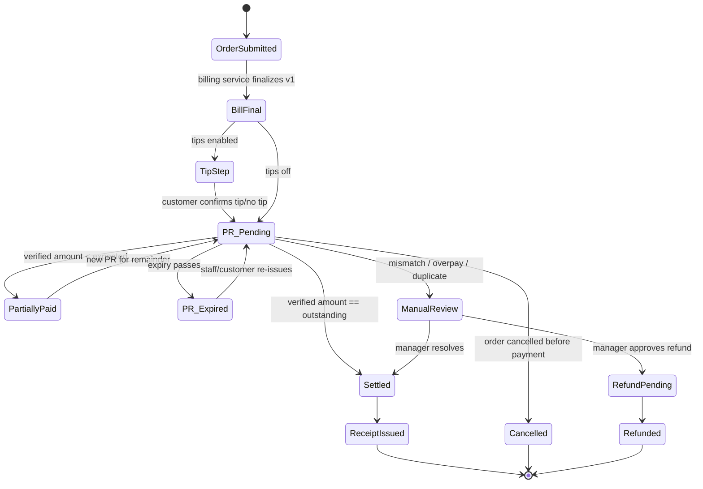
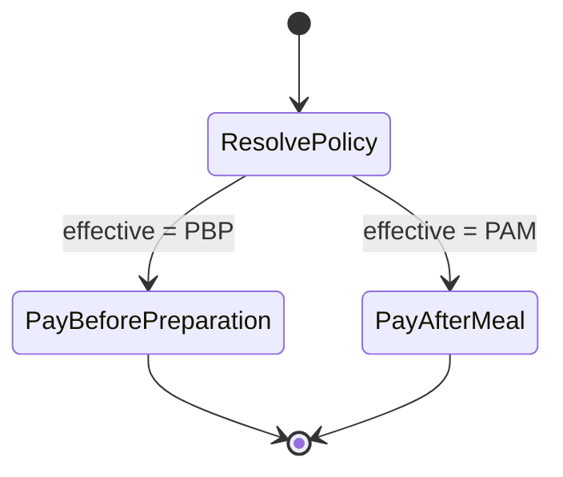

**Draft.**

# Payment Workflows: Bill → Payment Request → Payment → Receipt
> **DRAFT — Finance Manager, 2026-11-07, pending Founder/CEO review.**
> Sources: `FOUNDER_ORDER_2026-11-07.md` (this folder); `../TRONX_PRO_MAX_TASK_BOARD.md`; `/workspace/tronx-hq/projects/tasks.csv`. `PROVIDER_CAPABILITY_RESEARCH.md` did **not exist** at time of writing, so every provider fee, settlement timeline, capability, and report format below is **TBD**. The amounts are INR. Bill arithmetic belongs to `calculateRestaurantBill` (`lib/billing/calculate-bill.ts`). It exists in the ROS repo but not on the box, and Backend will supply its outputs. This doc defines no tax rules of its own. Provider facts remain TBD until PROVIDER_CAPABILITY_RESEARCH.md arrives from the CEO.

## 1. Separate objects (per Founder order 2)
| Object | Key fields | Status values |
|---|---|---|
| Order | orgId, outletId, orderId, orderType | (existing) |
| Bill (versioned) | billId, version, snapshot from `calculateRestaurantBill`, payableAmount, tipAmount | RUNNING → FINAL → (SUPERSEDED by a new version) → SETTLED / PARTIALLY_PAID / VOID |
| PaymentRequest (PR) | prId, billId+version, merchantAccountId, expectedAmount, currency=INR, expiry, providerRef | PENDING, SUCCESS, FAILED, EXPIRED, CANCELLED (incl. superseded), PARTIALLY_PAID*, MANUAL_REVIEW |
| Payment (collection) | paymentId, prId, providerPaymentRef, amount, method, verifiedVia (webhook-signature / status-check) | VERIFIED, FAILED, REFUND_PENDING, REFUNDED, MANUAL_REVIEW |
| Receipt | receiptId, billId+version, payments[] | ISSUED |

\*PARTIALLY_PAID sits on the **Bill**. A PR is single-amount: either it is paid in full, or it closes and a new PR is issued for the remainder (§4).

The Wave 1 payment ledger is the source of truth. Payment status changes only on a signature-verified webhook or an authenticated provider status check, and the handler is idempotent on providerPaymentRef. Front-end amounts are never trusted.

## 2. Common guards (all modes)
- G1: A PR is created only from a FINAL bill version, and the amount comes from the server-side bill (+ confirmed tip).
- G2: A PR is bound to one bill version and one merchant account and is never reused.
- G3: If the bill changes (items added or cancelled, discount, tip change), the open PR is CANCELLED (superseded), the bill gets a new version, and a new PR is issued.
- G4: The verification check must match merchant, providerRef, prId/orderRef, amount, currency and status. Any mismatch goes to MANUAL_REVIEW (§5).
- G5: The receipt and the WhatsApp confirmation are sent only after the Bill reaches SETTLED.
- G6: Exact-amount enforcement by the provider is **TBD** (PROVIDER_CAPABILITY_RESEARCH.md). Until it is confirmed, assume the payer can send any amount.
- G7: Captains cannot refund, settle or cash-close by default.

## 3. Modes
### 3.1 PAY_BEFORE_PREPARATION
Trigger for the bill: order submission. Kitchen release is a **separate policy** and is not forced by payment (Founder order).

If the order is cancelled after a verified payment, the case goes to REFUND_PENDING, which needs a manager role. The kitchen-release policy then reads Bill status as an input only.

### 3.2 PAY_AFTER_MEAL
A table session holds multiple orders and one running bill. Bill-timing triggers: customer request, captain, or checkout.
```mermaid
stateDiagram-v2
  [*] --> SessionOpen
  SessionOpen --> RunningBill: orders added (snapshots kept)
  RunningBill --> RunningBill: more orders / cancels (new snapshot)
  RunningBill --> BillFinal: bill requested (customer/captain/checkout)
  BillFinal --> RunningBill: items added after final (version++, old PR superseded)
  BillFinal --> TipStep: tips enabled
  TipStep --> PR_Pending
  BillFinal --> PR_Pending: tips off
  PR_Pending --> PartiallyPaid
  PartiallyPaid --> PR_Pending: remainder PR
  PR_Pending --> Settled
  PR_Pending --> PR_Expired
  PR_Expired --> PR_Pending
  PR_Pending --> ManualReview
  Settled --> ReceiptIssued --> SessionClosed
  SessionClosed --> [*]
```
The table session cannot close while the Bill is PARTIALLY_PAID or MANUAL_REVIEW, unless a manager overrides it with an audited reason.

### 3.3 FLEXIBLE
The effective policy (3.1 or 3.2) is resolved per order and stamped on the order at creation, so later setting changes don't affect open orders. Precedence **[CEO product default (2026-11-07), configurable per restaurant, Founder may override; not yet Founder-confirmed]** (D1): outlet + order-type rule > outlet default > org + order-type rule > org default. Managers always see the effective policy.

Terminal states in all modes: ReceiptIssued/SessionClosed, Cancelled (no money), Refunded, and VOID (a manager-approved write-off, audited).

## 4. Partial payments and overpayments
| Case | Rule |
|---|---|
| **500 = 200 + 300** | PR1 (500) gets a verified 200. Record 200 in the ledger and set Bill = PARTIALLY_PAID (outstanding 300). PR1 → closed (it can't take more). Issue PR2 for 300 (outstanding comes from the ledger, not the UI) and resend on WhatsApp. Bill = SETTLED only when the 300 is verified on PR2. One receipt lists both payments. |
| Partial payments enabled? | **[CEO product default (2026-11-07), configurable per restaurant, Founder may override; not yet Founder-confirmed]** (D2): **OFF by default**, enabled per outlet. When OFF, any under-payment → MANUAL_REVIEW and no remainder PR is auto-issued. The 500 = 200 + 300 flow above applies only when the outlet has enabled partials. |
| Wrong amount, under | Same as partial if the outlet has enabled partials (D2). Otherwise → MANUAL_REVIEW. |
| Wrong amount, over (e.g. 600 on a 500 PR) | Never auto-settled as 600, and the excess is never booked as revenue or tip. **[CEO product default (2026-11-07), configurable per restaurant, Founder may override; not yet Founder-confirmed]** (D3): never auto-accepted → MANUAL_REVIEW. The **only** outcome is: the manager applies the expected amount and the excess is refunded through the provider (REFUND_PENDING → REFUNDED). It is never converted to a tip, revenue or credit. |
| Double payment (two verified payments on one PR, or a second PR paid after the Bill was SETTLED) | The first verified payment settles. The second → MANUAL_REVIEW → refund flow. Duplicate webhooks with the same providerPaymentRef are an idempotent no-op, not a double payment. |
| Late payment on a superseded/cancelled/expired PR | Never applied silently. → MANUAL_REVIEW, linked to the current bill version. A manager can apply it to the current outstanding amount (if it is ≤ outstanding) and re-issue a PR for the rest, or refund it. Any open current PR stays open until resolved, to avoid a second payment. **Proposal:** cancel the current PR when a late payment arrives. Founder/CTO to confirm. |
| Payment on wrong merchant/outlet | → MANUAL_REVIEW. Never moved between outlets in the ledger. |
| Tip in a partial | **[CEO product default (2026-11-07), configurable per restaurant, Founder may override; not yet Founder-confirmed]** (D4): payments cover the bill components first, and the tip only once the bill total is fully covered. Example: bill 500 + tip 50, pay 200 → bill 200 / tip 0; then pay 350 → bill 300 / tip 50. |

## 5. Reconciliation rules (provider settlement ↔ ledger)
Report format, fields, frequency, fees and settlement timing are **all TBD**, pending PROVIDER_CAPABILITY_RESEARCH.md. The rules below are provider-neutral. Output goes to PAYMENT_RECONCILIATION_REPORT.md (owner per Founder order).

**Match keys (in priority order):** 1) providerPaymentRef = ledger.providerPaymentRef; 2) fallback: provider order/PR ref = prId, plus merchantAccountId. Then check: amount (exact, in paise), currency INR, merchant account = outlet's account, status.
**Tolerance:** **zero.** No tolerance is sourced. If the provider deducts fees from settlements, gross = ledger amount and fees are a separate line. The fee schedule is TBD and is never estimated.

| Outcome | Action |
|---|---|
| Exact match on all checks | MATCHED |
| In report, not in ledger | MANUAL_REVIEW (possible missed webhook). An authenticated status check may *propose* a ledger entry, and a manager confirms it |
| In ledger as SUCCESS, missing from report after the expected settlement window | Window **TBD** (provider research). Until it is sourced, flag UNSETTLED_AGED for manual follow-up, not MANUAL_REVIEW by date |
| Amount, currency or merchant mismatch | MANUAL_REVIEW |
| Same providerPaymentRef twice in reports | DUPLICATE → MANUAL_REVIEW |
| Refund/chargeback lines | Matched to REFUND_PENDING/REFUNDED entries. Unmatched → MANUAL_REVIEW |
| Payment against superseded/cancelled/expired PR | MANUAL_REVIEW (§4) |
| Ledger SUCCESS that was verified neither via signature nor status check | MANUAL_REVIEW (should be impossible, so it gets audited) |

**MANUAL_REVIEW exactly when:** any verification-field mismatch; over- or under-payment when partials are disabled; overpayment; second payment on a settled bill; a payment on a non-current PR; a wrong merchant/outlet; a report line without a ledger entry; a duplicate report line; an unmatched refund or chargeback; or a webhook and status check that disagree. Only manager-plus roles resolve these, with a reason, and every action is audit-logged.


## Decision log: CEO product defaults (2026-11-07)
Each is a CEO product default (2026-11-07), configurable per restaurant, Founder may override; not yet Founder-confirmed.
| # | Decision |
|---|---|
| D1 | FLEXIBLE precedence: outlet+order-type rule > outlet default > org+order-type rule > org default. Effective policy is always shown to managers. |
| D2 | Partial payments are OFF by default and enabled per outlet. |
| D3 | Overpayment is never auto-accepted. It goes to MANUAL_REVIEW, and the only outcome is a provider refund of the excess. It is never converted to a tip. |
| D4 | In partial payments, bill components are paid first and the tip last. |
| D5 | The tip is outside `calculateRestaurantBill`. It is added after the bill total as its own ledger component, with no in-system tax, pending CA. |
| D6 | Percentage tip base = post-discount, pre-tax subtotal (the base is configurable). Rounded half-up to the whole rupee and shown before the customer confirms. |
| D7 | A discount is clamped to the subtotal (total ≥ 0). A discount above the subtotal is a validation error unless a manager overrides it, and every override is audited. |

## 6. Open questions
1. Whether to cancel the current PR when a late payment arrives (CTO/Founder).
2. Founder confirmation of D1–D7.
3. **Provider (TBD → PROVIDER_CAPABILITY_RESEARCH.md, from the CEO):** exact-amount enforcement, PR expiry limits, partial-payment support, refund API (needed for D3) and timing, settlement report format, keys and frequency, settlement timeline, fees/MDR, webhook retry behaviour.
