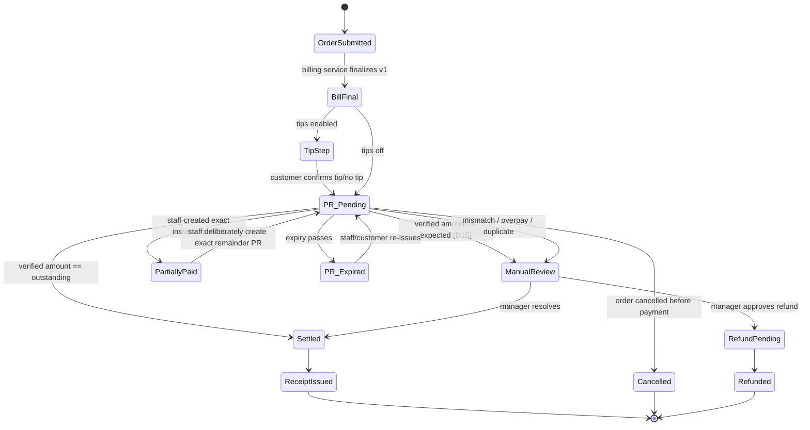
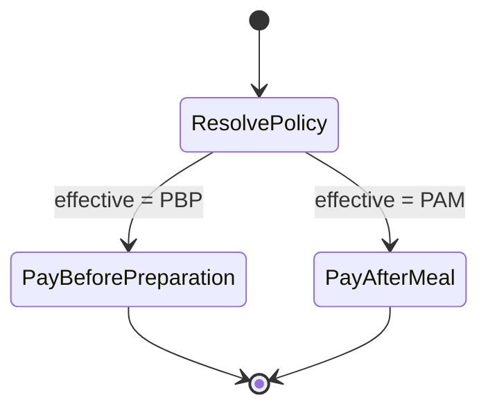

# Payment Workflows: Bill → Payment Request → Payment → Receipt
> **DRAFT — Finance Manager, 2026-11-07, pending Founder/CEO review.**
> Sources: `FOUNDER_ORDER_2026-11-07.md` (this folder); `../TRONX_PRO_MAX_TASK_BOARD.md`; `/workspace/tronx-hq/projects/tasks.csv`. `PROVIDER_CAPABILITY_RESEARCH.md` (this folder) is now cited where used; anything it does not state stays **TBD**. ADRs 0007/0009/0010 (this folder) and `CTO_REVIEW_SIX_DOCS.md` win over earlier text here. **Revision R2 (2026-11-07, 13:26 IST):** CTO verdict + ADR alignment applied (D13–D20); where an older section conflicts with D13–D20, D13–D20 win. The amounts are INR. Bill arithmetic belongs to `calculateRestaurantBill` (`lib/billing/calculate-bill.ts`). It exists in the ROS repo but not on the box, and Backend will supply its outputs. This doc defines no tax rules of its own. Provider facts remain TBD until PROVIDER_CAPABILITY_RESEARCH.md arrives from the CEO.

## 1. Separate objects (per Founder order 2)
| Object | Key fields | Status values |
|---|---|---|
| Order | orgId, outletId, orderId, orderType | (existing) |
| Bill (versioned) | billId, version, snapshot from `calculateRestaurantBill`, payableAmount, tipAmount | RUNNING → FINAL → SETTLED / PARTIALLY_PAID / VOID |
| PaymentRequest (PR) | supersededBy + reason + changed bill version (D16), prId, billId+version, merchantAccountId, expectedAmount, currency=INR, expiry, providerRef | **Canonical (D16):** CREATED, ACTIVE, PAID, SUPERSEDED, EXPIRED, CANCELLED, MANUAL_REVIEW, REFUNDED |
| Payment (collection) | paymentId, prId, providerPaymentRef, amount, method, verifiedVia (webhook-signature / status-check) | VERIFIED, FAILED, REFUND_PENDING, REFUNDED, MANUAL_REVIEW |
| Receipt | receiptId, billId+version, payments[] | ISSUED |

\*PARTIALLY_PAID sits on the **Bill**. A PR is single-amount and exact. It is PAID only when that exact amount is verified. A short/wrong amount → MANUAL_REVIEW (D15). A remainder request is created only by deliberate staff action.

The Wave 1 payment ledger is the source of truth. Payment status changes only on a signature-verified webhook or an authenticated provider status check, and the handler is idempotent on providerPaymentRef. Front-end amounts are never trusted.

## 2. Common guards (all modes)
- G1: A PR is created only from a FINAL bill version, and the amount comes from the server-side bill (+ confirmed tip).
- G2: A PR is bound to one bill version and one merchant account and is never reused.
- G3 (D16/D17): If the bill or balance changes (items, discount, tip add/change/remove → new billVersion), the ACTIVE PR is set to SUPERSEDED (with supersededBy) in the same transaction, and only then can a new PR be issued.
- G4: The verification check must match merchant, providerRef, prId/orderRef, amount, currency and status. Any mismatch goes to MANUAL_REVIEW (§5).
- G5: The receipt and the WhatsApp confirmation are sent only after the Bill reaches SETTLED.
- G6: Exact-amount enforcement by the provider is **TBD** (PROVIDER_CAPABILITY_RESEARCH.md). Until it is confirmed, assume the payer can send any amount.
- G7: Captains cannot refund, settle or cash-close by default.

## 3. Modes
### 3.1 PAY_BEFORE_PREPARATION
Trigger for the bill: order submission. Kitchen release is a **separate policy** and is not forced by payment (Founder order).

If the order is cancelled after a verified payment, the case goes to REFUND_PENDING, which needs a manager role. The kitchen-release policy then reads Bill status as an input only.

### 3.2 PAY_AFTER_MEAL
A table session holds multiple orders and one running bill. Bill-timing triggers: customer request, captain, or checkout.
```mermaid
stateDiagram-v2
  [*] --> SessionOpen
  SessionOpen --> RunningBill: orders added (snapshots kept)
  RunningBill --> RunningBill: more orders / cancels (new snapshot)
  RunningBill --> BillFinal: bill requested (customer/captain/checkout)
  BillFinal --> RunningBill: items added after final (version++, old PR superseded)
  BillFinal --> TipStep: tips enabled
  TipStep --> PR_Pending
  BillFinal --> PR_Pending: tips off
  PR_Pending --> PartiallyPaid: staff-created exact instalment PAID
  PartiallyPaid --> PR_Pending: staff deliberately create exact remainder PR
  PR_Pending --> Settled
  PR_Pending --> PR_Expired
  PR_Expired --> PR_Pending
  PR_Pending --> ManualReview
  Settled --> ReceiptIssued --> SessionClosed
  SessionClosed --> [*]
```
The table session cannot close while the Bill is PARTIALLY_PAID or MANUAL_REVIEW, and never while anything is in MANUAL_REVIEW or a request is ACTIVE and unexpired (D18, no override).

### 3.3 FLEXIBLE
The effective policy (3.1 or 3.2) is resolved per order and stamped on the order at creation, so later setting changes don't affect open orders. Precedence (D14, ADR 0009): order-level Manager/Admin override with reason > table/session override > outlet order-type/channel map > outlet default > org default > compatibility default PAY_AFTER_MEAL (labelled as defaulted). FLEXIBLE expands to a concrete rule. Managers see the winning source and config version. Kitchen release is resolved separately.

Terminal states in all modes: ReceiptIssued/SessionClosed, Cancelled (no money), Refunded, and VOID (a manager-approved write-off, audited).

## 4. Partial payments and overpayments
| Case | Rule |
|---|---|
| **500 = 200 + 300** (D15) | Partials must be ON for the outlet. A **Cashier/Manager/Admin deliberately creates** an exact 200 instalment request (the 500 request is superseded in the same transaction, D17). When the 200 is verified, PR(200) = PAID and the bill = PARTIALLY_PAID, outstanding 300 from the ledger. Staff **deliberately create** the exact 300 request; it is never auto-issued, and it is resent on WhatsApp. The bill is SETTLED when the 300 is verified. A customer paying 200 against a 500 request is **not** this flow: it goes to MANUAL_REVIEW. |
| Partial payments enabled? | D2: **OFF by default**, enabled per outlet. When ON, staff may create exact instalments (D15). Never auto-issued. |
| Wrong amount, under | Always MANUAL_REVIEW, even with partials ON (D15). Money is held unapplied. Manager/Admin: apply as a one-off instalment (audited, issues a new exact-balance request; D13) or refund. |
| Wrong amount, over (e.g. 600 on a 500 PR) | Never auto-settled as 600, and the excess is never booked as revenue or tip. **[CEO product default (2026-11-07), configurable per restaurant, Founder may override; not yet Founder-confirmed]** (D3): never auto-accepted → MANUAL_REVIEW. The **only** outcome is: the manager applies the expected amount and the excess is refunded through the provider (REFUND_PENDING → REFUNDED). It is never converted to a tip, revenue or credit. |
| Double payment (two verified payments on one PR, or a second PR paid after the Bill was SETTLED) | The first verified payment settles. The second → MANUAL_REVIEW → refund flow. Duplicate webhooks with the same providerPaymentRef are an idempotent no-op, not a double payment. |
| Late payment on a SUPERSEDED, CANCELLED, or EXPIRED PR | **ADR 0007:** a SUPERSEDED or CANCELLED payment goes to MANUAL_REVIEW and is never applied silently. An EXPIRED payment auto-matches only if the bill version is unchanged and the amount matches exactly; otherwise MANUAL_REVIEW. The current request is not auto-cancelled. The current open PR stays live, and staff UI shows a "payment pending review" warning. Only Manager/Admin resolves. On apply: balance recalculated from the ledger → if still outstanding, the current PR stays for the rest. If now covered, the current PR is cancelled/expired where the provider allows (TBD), and any excess (incl. a second payment that then lands on the live PR) → refund per D3. Or the Manager/Admin refunds the late payment in full. |
| Payment on wrong merchant/outlet | → MANUAL_REVIEW. Never moved between outlets in the ledger. |
| Tip in a partial | D4: verified money goes to bill components first and the tip last. Example: bill 500 + tip 50; staff create an exact 200 instalment → verified → bill 200 / tip 0; staff create an exact 350 → verified → bill 300 / tip 50. |

## 4a. Close guard and post-close exceptions (D18, D19)
- **Close bill** is blocked atomically while any associated item is in MANUAL_REVIEW, or any request is ACTIVE and not yet expired. There is no override (D10 → D18).
- **Post-close money**, and a payment that races a close/terminate call or arrives after a request was closed/expired, → MANUAL_REVIEW as a post-close exception. Finance reconciles it, and the bill is **never silently reopened**. The verified collection evidence is preserved. The outcome is Manager/Admin apply-to-exception or refund, audited.
- Provider closure is best effort and cannot be assumed to stop an authorised transfer (PROVIDER_CAPABILITY_RESEARCH.md §11 item 6). Per-provider close/expiry behaviour: §2 table, §3 (Razorpay close API; `qr_code.closed` is not triggered on auto-expiry), §4 (Cashfree terminate may return `TERMINATION_REQUESTED`; active payments can prevent termination). PayU cancel guarantees and a Paytm close API are **UNVERIFIED** (§2). The provider is not yet selected (§12).

## 5. Reconciliation workflow (ROS-E15-T007)
The board names no filename for T007, so this section is the T007 deliverable. Board ACs: a late payment on a superseded/expired request → Manual review, never Paid (D8, §4, §5.2). Wrong amount/duplicate → MANUAL_REVIEW, and the bill is Paid once (§4, §5.1). The ledger stays the source of truth (§1, §5.2).

### 5.1 Provider settlement ↔ ledger
Provider not yet selected (PROVIDER_CAPABILITY_RESEARCH.md §12). Published fees are list prices, not merchant quotations (§8). Settlement timing is as agreed in the PA–merchant agreement, not a universal T+1 (§9). Cashfree's settlement report exposes UTRs, fees, taxes, refunds and transaction refs (§4). Exact report schema, windows and fees for TRONX merchants remain **TBD**. The rules below are provider-neutral. Output goes to PAYMENT_RECONCILIATION_REPORT.md (owner per Founder order).

**Match keys (in priority order; dedupe identity = provider + environment + merchant + payment ref + entry kind, per CTO review):** 1) providerPaymentRef = ledger.providerPaymentRef; 2) fallback: provider order/PR ref = prId, plus merchantAccountId. Then check: amount (exact, in paise), currency INR, merchant account = outlet's account, status.
**Tolerance:** **zero.** No tolerance is sourced. If the provider deducts fees from settlements, gross = ledger amount and fees are a separate line. The fee schedule is TBD and is never estimated.

| Outcome | Action |
|---|---|
| Exact match on all checks | MATCHED |
| In report, not in ledger | MANUAL_REVIEW (possible missed webhook). An authenticated status check may *propose* a ledger entry, and a manager confirms it |
| In ledger as SUCCESS, missing from report after the expected settlement window | Window **TBD** (provider research). Until it is sourced, flag UNSETTLED_AGED for manual follow-up, not MANUAL_REVIEW by date |
| Amount, currency or merchant mismatch | MANUAL_REVIEW |
| Same providerPaymentRef twice in reports | DUPLICATE → MANUAL_REVIEW |
| Refund/chargeback lines | Matched to REFUND_PENDING/REFUNDED entries. Unmatched → MANUAL_REVIEW |
| Payment against superseded/cancelled/expired PR | MANUAL_REVIEW (§4) |
| Ledger SUCCESS that was verified neither via signature nor status check | MANUAL_REVIEW (should be impossible, so it gets audited) |

### 5.2 MANUAL_REVIEW resolution workflow
1. **Raise:** create a review item with: type, paymentId/providerRef, prId, bill+version, expected amount, received amount, ledger balance at the time, and source (webhook / status check / settlement report). The ledger records the received money as *unapplied* (it is not revenue, not a tip, and not settled).
2. **Warn:** the bill shows "Needs review" (UX_SPEC status label) and a "payment pending review" warning. Close bill is blocked while any review item is open or any request is ACTIVE and unexpired (D18). No override.
3. **Resolve (Manager/Admin only, reason required, audited):** the allowed actions are
   - **Apply:** the amount is applied up to the outstanding amount as recalculated from the ledger. Any excess → D3 refund.
   - **Refund:** full provider refund (REFUND_PENDING → REFUNDED). Refund API and timing are TBD.
   - **Match to existing:** for a report line whose ledger entry already exists (missed webhook), confirmed against an authenticated provider status check.
4. **After resolve:** recalculate the balance from the ledger. If it is 0, the bill → SETTLED, the current PR is cancelled/expired where the provider allows (TBD), and the receipt is sent. If > 0, the current PR is SUPERSEDED in the same transaction (D17), and a new exact-balance request is issued only by deliberate staff action (D13/D15).
5. **Never:** auto-resolve, convert money to a tip (D3), move money across outlets, or mark a bill Paid twice.
6. **Audit:** each raise/resolve records actor, role, action, reason, timestamp, and before/after balance.

**MANUAL_REVIEW exactly when:** any verification-field mismatch; over- or under-payment when partials are disabled; overpayment; second payment on a settled bill; a payment on a non-current PR; a wrong merchant/outlet; a report line without a ledger entry; a duplicate report line; an unmatched refund or chargeback; or a webhook and status check that disagree. Only manager-plus roles resolve these, with a reason, and every action is audit-logged.


## Decision log: D1–D20 (2026-11-07)
D1–D7 are CEO product defaults (2026-11-07), configurable per restaurant, Founder may override; not yet Founder-confirmed. D8 is a CEO product default (2026-11-07), Founder may override. D9 is a Finance proposal pending Founder confirmation. D10: PD proposal, pending CTO confirmation. D11: PD interim, pending CTO decision. D12: PD default, Founder may override. D13: CEO default pending Founder. D14: CTO/ADR alignment. D15–D20: CTO decisions (override earlier entries where they conflict). D9 and the 'Tip (voluntary)' label are defaults pending Founder; the CEO is bundling D1–D9 for him.
| # | Decision |
|---|---|
| D1 | ~~Replaced by D14 (ADR 0009 six-level precedence).~~ Was: FLEXIBLE precedence: outlet+order-type rule > outlet default > org+order-type rule > org default. Effective policy is always shown to managers. |
| D2 | Partial payments are OFF by default and enabled per outlet. When ON, this means staff may create exact instalment requests (D15). An underpayment is never an instalment. |
| D3 | Overpayment is never auto-accepted. It goes to MANUAL_REVIEW, and the only outcome is a provider refund of the excess. It is never converted to a tip. |
| D4 | Verified money (exact instalments or Manager/Admin-applied reviews) is allocated to bill components first and the tip last. |
| D5 | The tip is outside `calculateRestaurantBill` as its own ledger component, composed and finalized by B (no second writer). Its tax treatment is **narrowed by D20**: kept outside the tax calculation (`calculateRestaurantBill`); its GST treatment is pending CA confirmation, and live tips are gated on Finance/CA sign-off. |
| D6 | Percentage tip base = post-discount, pre-tax subtotal (the base is configurable). Cap: default 25% of that base (D14). The tip is computed in integer paise, then rounded half-up to the whole rupee, and shown before the customer confirms (ADR 0010). |
| D7 | A discount is clamped to the subtotal (total ≥ 0). A discount above the subtotal is a validation error unless a manager overrides it, and every override is audited. |
| D8 | Late payment on SUPERSEDED or CANCELLED goes to MANUAL_REVIEW (ADR 0007). A late payment on EXPIRED auto-matches only if the bill version is unchanged and the amount matches exactly; otherwise it goes to MANUAL_REVIEW. The current request is never auto-cancelled. The current open request stays live, and the UI warns "payment pending review". Only Manager/Admin resolves. On apply, the balance is recalculated from the ledger. If it is now covered, the current request is cancelled/expired **where the provider allows** (TBD, PROVIDER_CAPABILITY_RESEARCH.md), and any excess follows D3 (refund). *CEO product default 2026-11-07, Founder may override.* **R2 amendments:** a payment after a closed request, or after an EXPIRED request whose bill changed or whose amount does not match, takes the MANUAL_REVIEW path. An EXPIRED payment that matches the unchanged bill exactly is auto-matched (ADR 0007) (close/terminate can race an active payment; PROVIDER_CAPABILITY_RESEARCH.md §3 Razorpay `qr_code.closed` is not sent on auto-expiry; §4 Cashfree terminate may return `TERMINATION_REQUESTED` and active payments can prevent it, and an EXPIRED link can coexist with a successful payment; §11.6). When Manager/Admin applies the late money, the ledger balance changes, so the current request is SUPERSEDED in the same transaction (D17) and a new exact-balance request is issued only by staff action. |
| D9 | Tip base = **post-discount, pre-tax item subtotal**. Packaging and any service charge are **excluded** (a tip on service charge double-charges for service, and packaging is not service). Confirms the Designer's worked example (UX_SPEC §5). *Finance proposal, pending Founder confirmation.* |
| D10 | A bill **cannot be closed** while any payment on it is in MANUAL_REVIEW. The review must be resolved first, and there is no override. *PD proposal 2026-11-07, pending CTO confirmation.* |
| D11 | **SUPERSEDED by D16 (CTO decision, ADR 0007).** Was: "Superseded" is a **flag on the old payment request** (e.g. `supersededBy` + reason), **not** a ledger or bill status. *PD interim, pending CTO decision.* |
| D12 | When the tip base is ₹0, the tip prompt is **hidden entirely**, with no %, fixed or custom tip. *PD default, Founder may override.* |
| D13 | Short/wrong payment when partials are OFF: stays **unapplied** in MANUAL_REVIEW. Manager/Admin either (a) applies it as a **one-off instalment**, an audited override that issues a new request for the exact ledger balance, or (b) refunds it. It is never auto-applied. *CEO default 2026-11-07, pending Founder.* |
| D14 | **ADR alignment:** where these drafts differ from ADR 0009/0010, the ADR wording wins. Policy precedence (ADR 0009, replaces D1): order-level Manager/Admin override with reason > table/session override > outlet order-type/channel map > outlet default > org default > compatibility default `PAY_AFTER_MEAL` (labelled as defaulted). FLEXIBLE expands to a concrete rule. The policy is snapshotted per order/bill. Kitchen release is a separate resolver, and the verified-payment kitchen gate excludes the tip (CTO review). Tips (ADR 0010): integer paise; configurable cap, **default 25% of the post-discount pre-tax subtotal**, server-enforced for fixed, % and custom; a tip add/change/remove **increments billVersion** and supersedes the old request; disabling tips affects **new bills only**. *CTO/ADR, CEO note 2026-11-07.* |
| D15 | **An underpayment is never an instalment.** An instalment is only an exact-amount request deliberately created by Cashier/Manager/Admin (captains display/share only). Any short or wrong amount → MANUAL_REVIEW, even with partials ON. Partials are OFF by default (D2). Allocation of verified money: bill components first, tip last (D4). *CTO decision, overrides earlier D2/D4 flow.* |
| D16 | Supersession follows ADR 0007: **SUPERSEDED is a canonical request status** with `supersededBy` lineage + reason + the changed bill version. Canonical request enum (CTO review): CREATED, ACTIVE, PAID, SUPERSEDED, EXPIRED, CANCELLED, MANUAL_REVIEW, REFUNDED. PARTIALLY_PAID belongs to the bill. FAILED / REFUND_PENDING describe attempts/refund operations. *CTO decision; replaces D11.* |
| D17 | Any change to the **balance or the bill version** supersedes the current ACTIVE request **in the same transaction** (B single writer) before any new request is issued. Only one ACTIVE request per bill. *CTO decision.* |
| D18 | Close guard (extends D10): a bill cannot close while any associated payment/request is in MANUAL_REVIEW **or any request is ACTIVE and not yet expired**. No override. *CTO decision.* |
| D19 | **Post-close exception:** money arriving after the bill is closed → MANUAL_REVIEW, reconciled by Finance; the bill is **never reopened silently**. The same path covers the race between a close/terminate call and an in-flight payment, and a payment arriving after a request was closed/expired (D8): provider closure is best effort (PROVIDER_CAPABILITY_RESEARCH.md §3, §4, §11.6). *CTO decision + CEO note.* |
| D20 | Tip tax wording (narrows D5): never say tips are untaxed. The tip is kept outside the tax calculation (`calculateRestaurantBill`); its GST treatment is pending CA confirmation, and live tips are gated on Finance/CA sign-off. *CTO decision.* |

## 6. Open questions
1. Founder confirmation of D1–D9, D12, D13 and the 'Tip (voluntary)' label (CEO bundling D1–D9); ADR 0007/0009/0010 remain Proposed.
2. **Provider (TBD → PROVIDER_CAPABILITY_RESEARCH.md, from the CEO):** exact-amount enforcement, PR expiry limits, partial-payment support, refund API (needed for D3) and timing, settlement report format, keys and frequency, settlement timeline, fees/MDR, webhook retry behaviour.
