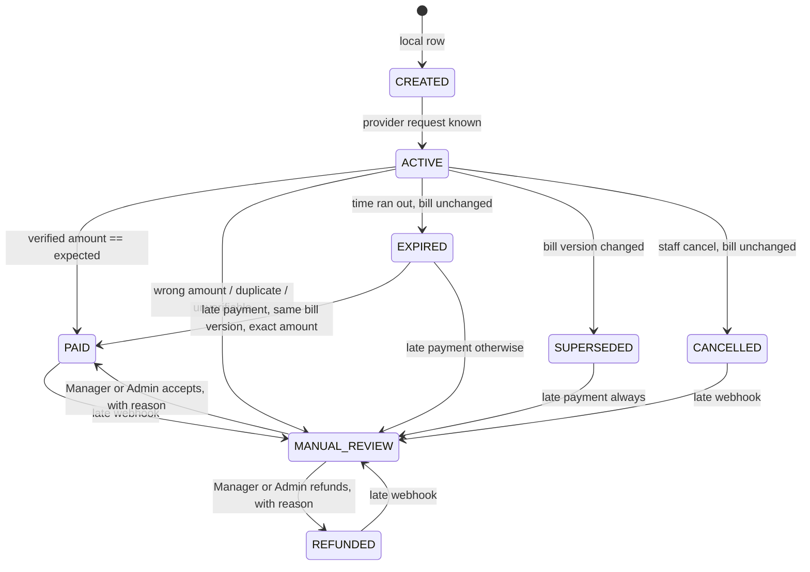

# UX SPEC — WhatsApp Billing, Dynamic UPI QR, Billing Policies & Optional Tips

**Owner:** TRONX UI UX DESIGNER · **Status:** v1.1 (2026-11-07, IST) · Task: ROS-E15-T003 · **Source:** `FOUNDER_ORDER_2026-11-07.md` (Orders 1 & 2), `../TRONX_PRO_MAX_MASTER_PLAN.md`, `../TRONX_PRO_MAX_TASK_BOARD.md`, `/workspace/tronx-hq/design/research/restaurant-os-ux-patterns.md`.
**Format:** Markdown only (Figma account is View seat; no editable file). ASCII wireframes are layout intent, not pixel spec.

## Changelog
| Version | Date (IST) | Change |
|---|---|---|
| v1.1 | 2026-11-07 | ROS-E15-T003: all TBD-PD tags replaced with ROS-E15 IDs from the board; screen sections mapped to frontend tasks ROS-E15-T036–T044; aligned with CEO defaults D1–D7 (+ CEO defaults on manual-review roles, WhatsApp template, tip copy), each flagged *pending Founder confirmation*; tip % worked example; partial payments OFF by default; overpayment → Manual review + refund; §15 rewritten to match the board's Open questions. |
| v0.1 | 2026-11-07 | First draft. |

> **Defaults legend.** D1–D7 are CEO product defaults logged by Finance (`TIP_ACCOUNTING_AND_RECONCILIATION.md`, "Decision log"), configurable per restaurant, **AWAITING FOUNDER CONFIRMATION**. Items marked "CEO default (unnumbered)" were relayed with D1–D7 but are not in that log; same status.

> **Ground rules baked into every screen**
> 1. Never show **Paid** until the server reports a *verified* payment (signature-verified webhook or authenticated status check). In doubt → **Pending** or **Manual review**.
> 2. Amounts always come from the server-side bill / payment request. The UI never computes the payable it sends to a provider.
> 3. Never claim exact-amount enforcement unless the provider guarantees it (**verify with provider**). Copy says "QR for ₹550" not "you can only pay ₹550".
> 4. Tips: when `ENABLE_CUSTOMER_TIPS` is OFF for the outlet/order type, **no tip UI, component, placeholder or receipt line exists** (historical receipts excepted). When ON: nothing preselected, explicit confirm. Never say a tip goes to a specific employee.
> 5. Secrets never displayed. Masked fields, write-only.
> 6. Money settles provider → restaurant's own merchant account. No TRONX wallet copy anywhere.

---

## 0. Contents
1. Task ID traceability
2. Concepts & vocabulary (UI-facing)
3. Payment request state machine (mermaid)
4. Screen 1 — Customer WhatsApp bill message
5. Screen 1b — Customer payment web page (+ tip step)
6. Screen 2 — Captain bill / QR / status
7. Screen 3 — POS payment panel
8. Screen 4 — Admin › Settings › Payments & WhatsApp (A/B/C)
9. Screen 4b — Settings › Billing & Payments › Billing Preferences + Effective policy
10. Screen 5 — State catalogue (customer / captain / POS)
11. Receipt
12. Design tokens
13. Visual direction
14. Accessibility & localisation
15. Open questions (Project Director / CTO)
16. Handoff checklist

---

## 1. Task ID traceability

This work is Epic **ROS-E15** (Stream O) on the board. Screen → frontend task: Screen 1 → ROS-E15-T038 · Screen 1b → ROS-E15-T036 (tips component ROS-E15-T037) · Screen 2 → ROS-E15-T040 · Screen 3 → ROS-E15-T041 (shared logic ROS-E15-T039 for 2+3) · Screen 4 → ROS-E15-T042 · Screen 4b → ROS-E15-T043 · Screen 5 → ROS-E15-T044. Backend dependencies used below: T023 (secrets), T024 (payment request/supersede), T025 (dynamic QR), T026 (webhook), T027 (state machine/ledger), T028 (partial/overpay guard), T029 (refunds), T030 (policy engine), T031 (bill versioning), T032 (tip records, default OFF), T033 (WhatsApp), T034 (security), T035 (fallbacks). Design: T003 (this spec), T004 (tokens/status chip/TEST band), T005 (a11y/l10n audit), T006 (design QA). QA: T009, T045, T046. Gate: T047.

Earlier-epic IDs this spec also touches:

| ID | Title (board) | Why it matters here |
|---|---|---|
| ROS-E04-T007 | PaymentAdapter interface with mock implementation (no live gateway) | The provider abstraction every payment screen talks to; demo = mock/sandbox only. |
| ROS-E04-T005 | Cashier/manager role for cash shift and refunds | Role gating: refund / settlement / cash close / manual-review resolution. |
| ROS-E04-T004 | Staff memberships: many managers / cashiers / kitchen per outlet | Who can see which outlet's payment settings. |
| ROS-E03-T001 | POS terminal preview uses calculateRestaurantBill | POS panel total must equal server bill. |
| ROS-E03-T002 | Captain order pad preview uses calculateRestaurantBill | Captain bill must equal server bill. |
| ROS-E03-T003 | Screen-vs-server bill parity unit test | Parity test guards the bill shown before QR. |
| ROS-E05-T001 | TablesManager labels/styles for BILL_REQUESTED, PAYMENT_PENDING, CLEANING | Table tile states align with payment status chips. |
| ROS-E05-T002 | Table admin API/schema accepts full floor status enum | Same statuses via API. |
| ROS-E08-T003 | Require Mongo replica set; fail startup if transaction probe fails | Payments never on non-transactional path. |
| ROS-E02-T003 | Public QR idempotency returns the existing order instead of bare 409 | Same idempotent "double-tap looks like success" pattern used for Send/Regenerate. (Note: "QR" there = table-ordering QR, not payment QR.) |
| ROS-E13-T004 / T005 / T007 | QA demo run / Playwright E2E / load with mock payment adapter | Acceptance criteria below are written to be E2E-able. |
| ROS-E14-T001 | UI shell invariants and sidebar-link process | New Settings entries go through the sidebar process. |

Acceptance criteria below are labelled `AC-<screen>-n` and tagged with board task IDs (mapping per the board section "UX_SPEC TBD-PD acceptance-criteria mapping"). No TBD-PD tags remain.

---

## 2. Concepts & vocabulary (UI-facing)

Kept separate in UI, as the order requires: **Order → Bill (versioned) → Payment request → Collection → Verification → Receipt.**

| Concept | UI label | Notes |
|---|---|---|
| Bill version | "Bill v2" | Increments when items change. Shown small, always. |
| Bill reference | "Ref TRX-A1B2-0042" | Format from backend; customer-facing. |
| Payment request | "Payment request" (staff) / not named to customer | One per (bill version, amount). |
| Remaining balance | "Remaining ₹300" | Server value. |
| Tip | "Tip (optional)" | Separate line; never "for your server". |

Statuses (ADR 0007 server enum → UI label): CREATED→"Preparing payment", ACTIVE→"Waiting for payment", PAID→"Paid · verified", SUPERSEDED→"Replaced · bill changed", EXPIRED→"Expired · same bill", CANCELLED→"Cancelled", MANUAL_REVIEW→"Needs review", REFUNDED→"Refunded". PARTIALLY_PAID is a bill label, "Partly paid", not a request status. "Checking…" is UI-only while a status check is in flight. SUPERSEDED and EXPIRED must not share copy.

---

## 3. Payment request state machine


Note: a replacement request gets a new id. PAID, SUPERSEDED, EXPIRED, CANCELLED, and REFUNDED stay terminal except when a late webhook moves that request to MANUAL_REVIEW. UI shows the latest active request and a history list.

---

## 4. Screen 1 — Customer WhatsApp bill message · ROS-E15-T038

**Purpose:** Deliver the finalized, itemized bill + payment link. **Entry:** Auto or manual send per Billing rules (§8C) after the bill is *finalized*. **Gating:** Only finalized bills; one send per bill version (resend is explicit, logged). Only to a number with consent recorded.

**Constraint:** WhatsApp Business templates are pre-approved by Meta; line-item lists of variable length may not fit a template body. **Verify with provider / CTO** (Q3). > **CEO default (unnumbered) — WhatsApp default template — pending Founder confirmation.** Default message = **summary** (restaurant, order no., total, tax total) + **secure itemized bill link**. The inline full item list (wireframe below) is used **only if template limits allow — verify with provider/Meta** (ROS-E15-T002, T013, T033).

**Default summary template (intent):**
```
*{{restaurant}}* · {{outlet}}
Order #{{order_no}} · Table {{table}} · {{date}} {{time}}
Total ₹{{payable}} (incl. tax ₹{{tax_total}})
Bill ref {{bill_ref}} · Bill v{{n}}
[ View bill & pay ]   ← CTA URL to secure itemized bill page
Link valid till {{expiry_time}}
```
The itemized fields required by the Founder order (items, qty, line totals, discounts, coupon, packaging, tax breakdown) are always on the linked page (§5).

**Optional inline itemized variant (only if template limits allow):**

### Content (template intent, English)
```
┌──────────────────────────────────────────┐
│ [Restaurant logo]                         │
│ *{{restaurant}}* · {{outlet}}             │
│ Order #{{order_no}} · Table {{table}}     │
│ {{date}} {{time}}                         │
│ ───────────────────────────               │
│ 2 × Paneer Tikka            ₹480.00       │
│ 1 × Butter Naan              ₹60.00       │
│ 1 × Sweet Lassi              ₹90.00       │
│ ───────────────────────────               │
│ Subtotal                    ₹630.00       │
│ Discount                    −₹63.00       │
│ Coupon WELCOME10            −₹50.00       │
│ Packaging                    ₹20.00       │
│ CGST 2.5%                    ₹13.43       │
│ SGST 2.5%                    ₹13.43       │
│ Round off                    +₹0.14      │
│ *Payable  ₹564.00*                        │
│ ───────────────────────────               │
│ Bill ref {{bill_ref}} · Bill v{{n}}       │
│ [ Pay ₹564 ]  ← CTA URL button            │
│ Link valid till {{expiry_time}}           │
└──────────────────────────────────────────┘
```
- Tax rows render only what the server bill contains (CGST/SGST or IGST; service charge if any). Rows with zero value are omitted.
- No tip line in the bill message (tip is chosen on the page, only if enabled).
- QR image in message: **only where template/provider supports media header** (verify); the link is primary.
- Copy for resend on new version: "Your bill was updated (v3). Earlier payment links no longer work. Pay ₹{{amount}}."
- Partial: "₹200 received. Remaining ₹300 — pay here."
- Confirmation/receipt messages are sent **only after verified payment**.

**Regional language:** One template per language (approved separately). Fields (item names) come from the menu's localised names if present; numbers stay Western Arabic digits with ₹.

**AC-1**
- AC-1.1 [ROS-E15-T031, ROS-E15-T038] Given a bill not yet finalized, When staff tap Send, Then the action is disabled with "Finalize bill first".
- AC-1.2 Given bill v2 already sent, When auto-send fires again for v2, Then no second message is sent and the log shows "Already sent".
- AC-1.3 Given items are added after send, When the bill is re-finalized, Then v3 is sent with the "bill was updated" copy and v2's link shows Superseded.
- AC-1.4 Given no consent recorded, Then send is blocked with "No WhatsApp consent for this number".

---

## 5. Screen 1b — Customer payment web page · ROS-E15-T036 (tip step ROS-E15-T037)

**Purpose:** Pay the exact server amount via UPI, simply. **Entry:** WhatsApp CTA link (signed, unguessable token). **Gating:** Public; token scoped to one payment request; no org IDs or billing settings in response (cf. public-menu hygiene principle). **Shows items?** Proposed: collapsible bill summary; confirm (Q5).

### Mobile (360–414)
```
┌───────────────────────────────┐
│  [Logo] Spice Route · Andheri │
│  Order #1042 · Table 7        │
├───────────────────────────────┤
│  Amount to pay                │
│        ₹564.00                │  ← 32sp bold
│  Ref TRX-A1B2-0042 · Bill v2  │
│  ▸ View bill (6 items)        │  ← expands itemized bill
├───────────────────────────────┤
│ [ (tip step here ONLY if ON) ]│
├───────────────────────────────┤
│ ┌───────────────────────────┐ │
│ │  [ Pay with UPI app  → ]  │ │  ← 56dp primary, upi:// intent
│ └───────────────────────────┘ │
│  Opens GPay, PhonePe, Paytm…  │
│                               │
│  ▸ Paying from another phone? │
│    Show QR                    │  ← reveals QR (min 240px)
│                               │
│  ⏱ Valid for 14:32            │  ← icon + text countdown
├───────────────────────────────┤
│ How to pay                    │
│ 1 Tap "Pay with UPI app"      │
│ 2 Check amount ₹564.00 & name │
│   Spice Route                 │
│ 3 Enter UPI PIN in your app   │
│ 4 Come back here — we confirm │
│   automatically               │
├───────────────────────────────┤
│ 🔒 Paid directly to Spice      │
│ Route's account via {{prov}}. │
│ We never ask for your UPI PIN.│
└───────────────────────────────┘
```
### Desktop (1280+)
```
┌────────────────────────────────────────────────────────────────┐
│ [Logo] Spice Route · Andheri          Order #1042 · Table 7    │
├───────────────────────────────┬────────────────────────────────┤
│ Bill (v2)                     │      Amount to pay             │
│ 2 × Paneer Tikka     ₹480.00  │        ₹564.00                 │
│ ... taxes ...                 │   ┌──────────────────┐         │
│ Payable              ₹564.00  │   │   [ QR 320px ]   │         │
│ Ref TRX-A1B2-0042             │   └──────────────────┘         │
│                               │   Scan with any UPI app        │
│ [tip step if ON]              │   ⏱ Valid for 14:32            │
│                               │   How to pay 1-2-3-4           │
└───────────────────────────────┴────────────────────────────────┘
```
Desktop: QR is primary (customer scans with phone). Mobile: intent button primary, QR secondary (you can't scan your own screen). Intent availability/behaviour on iOS **verify with provider** — fallback: show QR + "Save QR image" + copy UPI ID only if the provider issues a per-request VPA/reference (verify).

### Tip step (rendered ONLY if `ENABLE_CUSTOMER_TIPS` = ON for outlet + order type)
```
┌───────────────────────────────┐
│ Add a tip (optional)          │
│ ( No tip )( 5% ₹26 )( 10% ₹52)│  ← chips 56dp, NONE selected
│ ( 15% ₹78 )( Custom )         │  ← Custom only if permitted
│ Custom: [ ₹ ____ ]            │
│ Bill ₹564 + Tip ₹52 = ₹616    │  ← appears after a choice
│ [ Confirm ₹616 ]              │  ← explicit confirm, 56dp
└───────────────────────────────┘
```
- Pay button and QR are **hidden/disabled** until a tip choice is confirmed (incl. "No tip"). Disabled state shows "Choose a tip option to continue" — not a nudge toward tipping.
- Tip % amounts are computed and returned by the server; UI only displays them.

> **Default D6 — pending Founder confirmation.** % tip base = **post-discount, pre-tax subtotal** (base configurable), **rounded half-up to the whole rupee**, shown before confirm. Tip sits outside `calculateRestaurantBill` as its own ledger component (D5).

**Worked example (sample bill in §4):** subtotal ₹630 − discount ₹63 − coupon ₹50 = **base ₹517** (packaging and tax excluded). 5% = 25.85 → **₹26**; 10% = 51.70 → **₹52**; 15% = 77.55 → **₹78**. Bill payable ₹564 + ₹52 = **₹616** new QR. Founder-order example: ₹500 + ₹50 = ₹550.

> **CEO default (unnumbered) — tip copy — pending Founder confirmation; wording also tracked as ROS-E15-T008.** Neutral copy only: "Add a tip (optional)", "No tip". No guilt/pressure copy (e.g. no "Your server worked hard"), no claim that a tip goes to a specific person or to staff.
- On Confirm → server creates request for final amount → QR/intent regenerate (e.g. 500 + 50 = 550). Spinner "Preparing your QR…".
- "Change tip" link after confirm → cancels current request, new one after re-confirm.
- Custom: min ₹1, max per config; numeric keypad; validation inline.
- When OFF: section, chips, copy and any space are absent from DOM.

**Interactions:** Page polls / subscribes for status (HTTP polling today). On return from UPI app, show "Checking payment…" (Pending style) until server verified. Never infer success from the intent return.

**AC-1b**
- AC-1b.1 [ROS-E04-T007] Given a request for ₹564, When the page loads, Then the shown amount equals the server request amount and the QR encodes that request.
- AC-1b.2 [ROS-E15-T037] Given tips OFF for outlet/order type, Then no tip element is in the DOM and the receipt has no tip line.
- AC-1b.3 Given tips ON, When the page loads, Then no tip option is selected and Pay/QR are unavailable until the customer confirms a choice.
- AC-1b.4 Given bill ₹500 and tip ₹50 confirmed, Then a new request for ₹550 is shown and the ₹500 request is no longer payable.
- AC-1b.5 Given the customer returns from the UPI app, When no verified status exists, Then the page shows "Checking payment…" not "Paid".
- AC-1b.6 Given countdown reaches 0, Then QR/intent are replaced by the Expired state (§10).
- AC-1b.7 Given mobile viewport, Then "Pay with UPI app" is primary and QR is behind "Show QR"; on desktop QR is primary.

---

## 6. Screen 2 — Captain: bill / QR / status / remaining · ROS-E15-T040 (shared ROS-E15-T039)

**Purpose:** At the table, show the bill and get it paid fast. **Entry:** Captain table view → "Bill" (table in BILL_REQUESTED / PAYMENT_PENDING, ROS-E05-T001). **Gating:** Captain with payment permission. **No** refund, settlement, cash-close, manual-review resolve by default (ROS-E04-T005). Captain sees "Needs review — ask manager".

### Mobile (captain phone 360–414)
```
┌───────────────────────────────┐
│ ← Table 7 · Order #1042       │
│ Bill v2 · Ref TRX-A1B2-0042   │
├───────────────────────────────┤
│ ● Waiting for payment   ⏱13:20│ ← status chip icon+label
│ Payable          ₹564.00      │
│ Paid             ₹0.00        │
│ Remaining        ₹564.00      │ ← bold
├───────────────────────────────┤
│      ┌───────────────┐        │
│      │  [ QR 260px ] │        │ ← show screen to guest
│      └───────────────┘        │
│   Guest scans with any UPI app│
├───────────────────────────────┤
│ [ Resend on WhatsApp ]  56dp  │ ← last sent 12:04 ✓ Delivered
│ [ Other method ▾ ]      56dp  │ ← only authorized methods
│ ▸ View items                  │
│ ▸ Payment history (2)         │
└───────────────────────────────┘
```
Tablet/desktop (if captains use tablets): two columns — bill left, QR + actions right (same as POS layout, reduced actions).

- Live status via polling; status chip animates only on change (no constant motion).
- Tips: if ON, the tip is chosen by the customer on their page; captain QR shows "Ask guest to choose tip on their phone" OR (Q9) a guest-facing tip screen on captain device with the same rules (nothing preselected, guest confirms). Default proposal: captain screen shows final amount only after the guest's choice; no captain-side tip entry.
- "Other method": Cash (records tender; cash close remains cashier/manager), Card on EDC — only methods enabled for the role/outlet.
- Full-screen QR mode (tap QR) for showing to guest: max brightness hint, amount above QR.

**AC-2**
- AC-2.1 [ROS-E03-T002] Given the captain bill, Then payable equals the server bill (calculateRestaurantBill).
- AC-2.2 [ROS-E04-T005] Given a default captain role, Then Refund, Settle, Cash close and Resolve review are not rendered.
- AC-2.3 Given a webhook verifies ₹564, When the captain screen polls, Then status changes to "Paid · verified" and table status follows.
- AC-2.4 Given partial payments ON for the outlet (D2) and ₹200 verified of ₹500, Then status "Partly paid", Remaining ₹300, a new QR for ₹300, and "Resend ₹300 on WhatsApp".
- AC-2.5 Given WhatsApp send fails, Then a red-icon "Not delivered" note appears, QR stays usable, and "Bill available in POS" is shown.

---

## 7. Screen 3 — POS payment panel (tablet/desktop) · ROS-E15-T041 (shared ROS-E15-T039)

**Purpose:** Cashier settles any bill with the same shared payment logic. **Entry:** POS order → "Pay" (or F-key). **Gating:** Cashier/manager (ROS-E04-T005). Manual-review resolve and refund: Manager/Admin only (never Cashier/Captain).

### Desktop 1280+
```
┌──────────────────────────────────────────────────────────────────────────┐
│ Order #1042 · Table 7 · Dine-in     Bill v2 · Ref TRX-A1B2-0042   [TEST] │
├──────────────────────────────┬───────────────────────────────────────────┤
│ BILL                         │ PAYMENT                                   │
│ 2 × Paneer Tikka    ₹480.00  │ ● Partly paid                     ⏱ 12:10 │
│ 1 × Butter Naan      ₹60.00  │ Payable ₹500.00  Paid ₹200.00             │
│ ...                          │ Remaining  ₹300.00                        │
│ Discount            −₹63.00  │                                           │
│ CGST / SGST    ₹13.43/13.43  │ Method: [UPI QR][Cash][Card][Split]  64dp │
│ (Tip ₹50 — only if tipped)   │ ┌─────────────┐  Amount [ ₹300.00 ]       │
│ Payable            ₹500.00   │ │ [ QR 240 ]  │  [ Send on WhatsApp ]     │
│                              │ └─────────────┘  [ Show on customer disp.]│
│                              │                                           │
│                              │ History                                   │
│                              │ 12:01 UPI ₹200  ✓ Verified  prov ref …a91 │
│                              │ 12:05 UPI ₹300  ● Waiting                 │
│                              │                                           │
│                              │ [ Cancel request ]   [ Close bill ] (dis.)│
└──────────────────────────────┴───────────────────────────────────────────┘
```
Tablet (768–1279): same two columns, bill collapsible. Phone not a target for POS.

> **Default D2 — pending Founder confirmation.** Partial payments are **OFF by default**, enabled per outlet (§8C). When OFF, the Split control, amount field and "Remaining" partial UI are not rendered; one request for the full payable. **D4:** with a tip, bill components are paid first and the tip last.

- **Split/partial (only when ON):** "Split" → enter amount or "Split equally n ways"; each part = its own request; amount input capped at Remaining (overpay guard, ROS-E15-T028).
- **Close bill** enabled only when Remaining = ₹0, no PaymentRequest is MANUAL_REVIEW, and none is ACTIVE and unexpired (ADR 0008).
- **Manual review card** (in History, amber, icon ⚠):
  ```
  ⚠ Needs review — Received ₹520 for request ₹500 (prov ref …7c2)
    Reason: overpayment ₹20
    [ Refund excess ₹20 ] [ Add note ]          ← Manager/Admin only
  ```
  > **Default D3 — pending Founder confirmation.** Overpayment is never auto-accepted and never converted to a tip: it goes to MANUAL_REVIEW and the only outcome is a provider refund of the excess (ROS-E15-T029, T007).

  Other review reasons (late payment on old request, duplicate, unverifiable): actions [Apply to bill] (only if it doesn't exceed Remaining) / [Refund] / [Add note]. Every action needs reason + confirm dialog; audit logged.

  > **ADR 0008.** MANUAL_REVIEW is resolvable by **Manager or Admin only**, by accepting, refunding, or rejecting it with a reason. Captain and Cashier see the card read-only with "Ask a manager".
- **Test mode:** persistent striped "TEST MODE — no real money" banner + [TEST] badge.

**AC-3**
- AC-3.1 [ROS-E03-T001] POS payable equals server bill.
- AC-3.2 [ROS-E15-T041, ROS-E15-T028] Given Remaining ₹300, When cashier enters ₹350, Then input error "Max ₹300" and no request is created.
- AC-3.3 [ROS-E15-T041] Given a MANUAL_REVIEW item, When a Captain or Cashier views it, Then resolve actions are absent; a Manager/Admin sees them and must enter a reason.
- AC-3.6 [ROS-E15-T041, ROS-E15-T029] Given an overpayment of ₹20, Then the item is MANUAL_REVIEW, the only resolution is "Refund excess ₹20", and no tip line is created.
- AC-3.7 [ROS-E15-T041] Given partial payments OFF for the outlet, Then no Split/partial control is rendered.
- AC-3.4 Given a request is ACTIVE and unexpired, or any request is MANUAL_REVIEW, Then Close bill is disabled.
- AC-3.5 [ROS-E08-T003] Payments never shown as recorded if the server write failed; UI shows error + retry.

---

## 8. Screen 4 — Admin › Settings › Payments & WhatsApp · ROS-E15-T042

**Entry:** Admin sidebar › Settings › Payments & WhatsApp (via ROS-E14-T001 sidebar process). **Gating:** Owner/admin; manager read-only (Q10). Per outlet: outlet switcher at top, config fully isolated. **Secrets:** write-only masked fields ("••••••••3f2a · Updated 3 Nov"), "Replace" action; never revealed, never logged.

### Layout (desktop 1280+; mobile stacks cards, tabs become segmented list)
```
┌──────────────────────────────────────────────────────────────────────┐
│ Settings › Payments & WhatsApp      Outlet: [Andheri ▾]              │
│ ┌──────────── MODE ───────────┐                                      │
│ │ (●) Test   ( ) Live         │ Live locked until onboarding complete│
│ └─────────────────────────────┘ & Founder/owner approval             │
│ Tabs: [ A Payment provider ][ B WhatsApp Business ][ C Billing rules ]│
├──────────────────────────────────────────────────────────────────────┤
│ A. PAYMENT PROVIDER                                                  │
│ Provider  [ Select provider ▾ ]   (list from adapter registry)       │
│ Status    ● Connected (test) · last check 12:40                      │
│ Merchant  Spice Route Pvt Ltd · MID ••••4821 (verified by provider)  │
│ Onboarding  ✓ KYC  ✓ Bank  ○ Live keys          [ Continue onboarding]│
│ Capabilities (reported by provider — verify):                        │
│   Dynamic QR ✓  Payment link ✓  Exact-amount lock ?  Partial ?       │
│ UPI methods  [✓] UPI intent [✓] UPI QR [ ] Collect (if supported)    │
│ Webhook URL  https://…/api/payments/webhook/{outlet}  [Copy]         │
│ Webhook secret ••••••••  [Replace]   Last event 12:38 ✓ signature ok │
│ [ Test connection ]  [ Send test webhook ]                           │
└──────────────────────────────────────────────────────────────────────┘
```
Capabilities show "?" = "Not confirmed by provider" — dependent features (e.g. copy claiming exact amount) stay off.

**Test vs Live distinction:** Test = amber/striped top band, "TEST" pill in every payment screen across apps, sandbox QR watermarked "TEST". Live = no band, green "LIVE" pill in settings only. Switching to Live: modal listing checklist (onboarding complete, live credentials set, webhook verified, approval) + type outlet name to confirm.

### B. WhatsApp Business
```
│ Account     Spice Route (WABA ••••9910)  ● Connected                │
│ Number      +91 98••• ••210 · Display name approved ✓               │
│ Templates   bill_v1 (en) ✓ Approved | bill_v1 (hi) ⏳ Pending |      │
│             bill_update_v1 ✓ | partial_v1 ✓ | receipt_v1 ✗ Rejected │
│             [ View reason ]                                          │
│ Consent     Collected at: [✓] QR ordering [✓] Captain entry          │
│             Consent text (shown to guest): "Send my bill on WhatsApp"│
│ Delivery log [filter: status/date]                                   │
│  12:04 #1042 v2 +91••210  ✓✓ Read                                    │
│  11:50 #1039 v1 +91••777  ✗ Failed — invalid number                  │
```
Phone numbers masked in logs (last 3 digits).

### C. Billing rules (per outlet)
```
│ Send bill on WhatsApp   ( ) Automatically when finalized (●) Staff taps Send │
│ Send receipt            [✓] After verified payment                           │
│ Partial payments        [ ] Allow (default OFF, D2)   Min part ₹[ 1 ]        │
│ Payment link expiry     [ 15 ] minutes   (provider limits: verify)           │
│ Resend limit            [ 3 ] per bill version                               │
```

**AC-4**
- AC-4.1 [ROS-E04-T007] Given no live credentials, Then Live mode is disabled with the checklist explaining why.
- AC-4.2 [ROS-E15-T023, ROS-E15-T042] Given a saved secret, Then the UI and API responses show only masked last-4 and never the value.
- AC-4.3 Given outlet Andheri selected, Then no other outlet's merchant/WhatsApp data appears.
- AC-4.4 Given Test mode, Then every payment surface (customer, captain, POS) shows the TEST band.
- AC-4.5 Given a capability unconfirmed, Then it shows "?" and dependent copy is not enabled.

---

## 9. Screen 4b — Settings › Billing & Payments › Billing Preferences · ROS-E15-T043

**Gating:** Owner/admin edit; manager read (sees Effective policy). Per outlet.

```
┌──────────────────────────────────────────────────────────────────────┐
│ Billing Preferences                         Outlet: [Andheri ▾]      │
│ Payment policy                                                       │
│ ( ) Pay before preparation   ( ) Pay after meal   (●) Flexible       │
│ Flexible — by order type:                                            │
│   Dine-in      [Pay after meal ▾]                                    │
│   Takeaway     [Pay before preparation ▾]                            │
│   Delivery     [Pay before preparation ▾]                            │
│   Reservation  [Pay after meal ▾]                                    │
│ Kitchen release (separate)                                           │
│   [ Release to kitchen on order ▾ ] / on verified payment / manual   │
│ Bill timing  [✓] At order submission [✓] On customer request         │
│              [✓] By captain          [✓] At checkout                 │
│ Tips  ENABLE_CUSTOMER_TIPS  [ OFF ]  (default OFF)                   │
│   when ON: Order types [✓]Dine-in [ ]Takeaway …                      │
│            Suggestions [5]% [10]% [15]%  or fixed ₹[ ]               │
│            [✓] Allow custom   Max ₹[ ]                               │
├──────────────────────────────────────────────────────────────────────┤
│ EFFECTIVE POLICY (preview)                                           │
│ Order type  Pays          Kitchen gets order   Tips   Why            │
│ Dine-in     After meal    On order             Shown  Outlet + order │
│                                                       type rule      │
│ Takeaway    Before prep   On verified payment  Off    Outlet + order │
│                                                       type rule      │
│ Delivery    Before prep   On order             Off    Org + order    │
│                                                       type rule      │
│ Reservation After meal    On order             Off    Outlet default │
│ ⚠ Pay-before + release-on-order: kitchen may cook unpaid orders.     │
│ [ Save ]  (diff dialog: shows changed rows before saving)            │
└──────────────────────────────────────────────────────────────────────┘
```
> **Default D1 — pending Founder confirmation.** Precedence: **outlet + order-type rule > outlet default > org + order-type rule > org default.** The "Why" column names the winning level using exactly these four labels ("Outlet + order type rule", "Outlet default", "Org + order type rule", "Org default"), with a tooltip listing the lower levels it overrode. Policy resolved by ROS-E15-T030. Changes apply to new orders only; open orders keep their snapshot (shown as note).

Mobile: Effective policy becomes one card per order type.

**AC-4b**
- AC-4b.1 [ROS-E15-T032, ROS-E15-T043] Given a new outlet, Then tips are OFF.
- AC-4b.2 Given Flexible with Takeaway=Pay before, When a manager opens preview, Then Takeaway row shows "Before prep" and "Why: Outlet + order type rule".
- AC-4b.5 [ROS-E15-T043, ROS-E15-T030] Given no outlet rule for Delivery but an org + order-type rule exists, Then Delivery shows "Why: Org + order type rule".
- AC-4b.3 Given tips ON only for Dine-in, Then a takeaway customer page renders no tip UI.
- AC-4b.4 Given the policy changes, Then existing open orders keep their policy and a note says so.
- Test restaurants A/B/C from the order must be demonstrable through this screen.

---

## 10. Screen 5 — State catalogue · ROS-E15-T044

Every state = icon + label + short explanation + next action. Colour never alone.

| State | Customer page | Captain | POS |
|---|---|---|---|
| Pending | ⏳ "Waiting for payment" + countdown, QR/intent active | ● chip, QR, Resend | ● chip, QR, Cancel request |
| Checking | ⏳ "Checking payment…" (after app return / webhook delay) "This can take a minute. Don't pay again." | same | same |
| Partly paid (only if partial ON, D2) | ◐ "₹200 received. Remaining ₹300" + new QR/intent for ₹300 | ◐ Remaining ₹300, Resend ₹300 | ◐ History rows, new request |
| Expired | ⌛ "This payment link expired. No money was taken for it." [Get new QR] (if policy allows customer regenerate, else "Ask staff") | ⌛ [Regenerate] | ⌛ [Regenerate] |
| Superseded | ↻ "Your bill was updated (v3). This QR no longer works." [Open latest bill] | ↻ "Old v2 replaced" | ↻ v2 row struck, v3 active |
| Manual review | ⚠ "We received a payment that needs a quick check. Staff will help you. Please don't pay again." | ⚠ "Needs review — ask manager" | ⚠ review card, manager actions |
| Failed | ✕ "Payment didn't go through. If money left your account, it's usually returned by your bank (verify timelines with provider)." [Try again] | ✕ [New request] | ✕ [New request] / other method |
| Paid | ✓ "Paid · ₹564 · verified" + receipt — only after server PAID | ✓ | ✓ Close bill enabled only if no MANUAL_REVIEW and no ACTIVE unexpired request |
| WhatsApp failed / invalid no. | n/a | ✕ "Not delivered: invalid number" [Edit number][Show QR] "Bill is in POS" | same + log link |
| QR generation failed | ✕ "Couldn't create QR. Please pay at the counter." | ✕ "QR unavailable" → Other method | same |
| Provider down | ⏳ "Payments are slow right now. Please wait or pay staff." | ⚠ banner "Provider unreachable — use other methods" | same |
| Merchant disconnected | "Online payment unavailable. Please pay staff." | ⚠ banner | ⚠ banner + "Admin: reconnect" link (admin only) |
| Offline (device) | n/a (customer uses own network) | ⚡ "Offline — status may be out of date. Don't mark paid." QR shows "Last known status" | ⚡ persistent bar; UPI actions disabled; cash still recordable as "queued" |
| Refund pending / refunded | "Refund started ₹X" | view only | manager action |

Wireframe pattern (mobile state block):
```
┌───────────────────────────────┐
│  ⚠  Needs review              │
│  We received ₹520 for a ₹500  │
│  bill. Staff will help you.   │
│  Please don't pay again.      │
│  Ref TRX-A1B2-0042            │
└───────────────────────────────┘
```
**AC-5**
- AC-5.1 [ROS-E15-T027, ROS-E15-T044] Given a late payment on a SUPERSEDED request, Then every surface says "Replaced · bill changed" and Manual review, never Paid. Given a late payment on an EXPIRED request, Then it shows Paid only when the bill version is unchanged and the amount matches exactly; otherwise "Expired · same bill" and Manual review.
- AC-5.2 Given duplicate payment, Then the second payment shows Manual review; bill stays Paid once.
- AC-5.3 Given the device is offline, Then no surface can transition to Paid and UPI request actions are disabled.
- AC-5.4 Given WhatsApp fails, Then the bill remains accessible in POS and captain.

---

## 11. Receipt (customer page + WhatsApp, after verified payment only)
```
✓ Paid · verified
Spice Route · Andheri · GSTIN 27XXXXX
Invoice no {{serial}} · {{date time}}
Bill v2 · Ref TRX-A1B2-0042
Items … · Taxes … · Bill total ₹500.00
Tip                                 ₹50.00   ← ONLY if tipped
Total paid                          ₹550.00
Paid via UPI · provider ref …a91
[ Download PDF ]
```
Tip line separated visually from food/tax (Finance treatment TBD, no tax claim on tip). Partial: list each payment.

---

## 12. Design tokens

**Status colours (always with icon + label):**
| Token | Hex (light) | Icon | Label |
|---|---|---|---|
| status.pending | #B45309 on #FEF3C7 | ⏳ hourglass | Waiting / Checking |
| status.partial | #1D4ED8 on #DBEAFE | ◐ half-circle | Partly paid |
| status.paid | #047857 on #D1FAE5 | ✓ check-circle | Paid · verified |
| status.review | #9A3412 on #FFEDD5 | ⚠ triangle | Needs review |
| status.failed | #B91C1C on #FEE2E2 | ✕ x-circle | Failed |
| status.expired | #4B5563 on #F3F4F6 | ⌛ timer-off | Expired · same bill |
| status.superseded | #4B5563 on #F3F4F6 | ↻ refresh | Replaced · bill changed |
| status.offline | #374151 on #E5E7EB | ⚡ wifi-off | Offline |
| mode.test | #92400E stripes #FDE68A | flask | TEST MODE |
| mode.live | #047857 | dot | LIVE |
All text/background pairs target ≥4.5:1 (verify in build). Dark-mode variants TBD.

**Type scale (Inter/Noto Sans + Noto Sans Devanagari UI / Tamil UI etc.):** display 32/40 bold (amount), title 20/28 semibold, body 16/24, caption 13/18, mono-ish tabular numbers for money (`font-variant-numeric: tabular-nums`). Indic line-height ×1.15 extra.

**Spacing:** 4-pt base: 4, 8, 12, 16, 24, 32, 48. Card padding 16 (mobile) / 24 (desktop). Radius 12 cards, 10 buttons.

**Touch targets:** primary 56dp (mobile) / 64dp (POS); secondary ≥48dp; min gap 8dp. QR min 240px mobile, 320px desktop, quiet zone ≥4 modules, never scaled below provider spec (verify).

---

## 13. Visual direction — premium, simple
- One hero number (amount) per screen; one primary action.
- White/neutral surfaces, single brand accent (from restaurant brand if supplied, else TRONX neutral); status colours only for status.
- No confetti or upsell. Success = calm green check + receipt.
- Trust row ("Paid directly to {restaurant}'s account via {provider}") — exact wording verified with provider/legal.
- Few taps: customer = 1 tap (intent) or 2 with tip (choose + confirm); captain = 0–1 (QR auto-shows); POS = 1 (method) + close.

## 14. Accessibility & localisation
- WCAG 2.2 AA contrast; focus rings; screen-reader labels: QR `alt="UPI QR code for ₹564.00, Spice Route"`; countdown announced at 5 min and 1 min (aria-live polite), not every second.
- Status changes announced via aria-live.
- Don't rely on colour; icons + text.
- Respect reduced motion.
- Strings externalised (ICU messages), placeholders for amounts; allow 40% text expansion; Noto UI fonts for Indic scripts; ₹ formatting via Intl (en-IN grouping 1,25,000). WhatsApp templates per language need separate approval.
- Offline/error copy plain and specific (research doc §4).

## 15. Open questions (aligned with board "Open questions" 2026-11-07)
Board numbering in brackets. Status: **Open**, **Resolved**, **Awaiting Founder**.

| # | Question | Who decides | Status |
|---|---|---|---|
| Q1 | Task IDs / epic for this work | PD | **Resolved** — Epic ROS-E15 (Stream O); TBD-PD mapping on board |
| Q2 [board 8] | Payment provider and which capabilities are guaranteed (exact-amount lock, links, partial, iOS intent, expiry, refund API) | Founder, then CTO verifies (ROS-E15-T001) | **Awaiting Founder** — all "verify with provider" markers stay |
| Q3 [board 14] | Template constraints: itemized list in template vs summary + link/PDF; QR as media header; BSP vs Cloud API | CTO (ROS-E15-T002, T013) | Open — CEO default: summary + secure link (§4), pending Founder |
| Q4 [board 15] | Policy precedence | PD proposes, Founder confirms | Default D1 applied, **Awaiting Founder** |
| Q5 [board 16] | Can the public payment page show the itemized bill? | PD with CTO security review | Open — spec assumes yes (needed by §4 default) |
| Q6 [board 17] | "Superseded" own status or CANCELLED + reason | CTO | **Resolved** — ADR 0007: SUPERSEDED is its own status |
| Q7 [board 18] | Customer-facing tip wording | Finance; **Founder for wording** (ROS-E15-T008) | Neutral-copy default applied, **Awaiting Founder** |
| Q7b [board 18] | Tip % base | Finance | Default D6 applied, Awaiting Founder |
| Q8 [board 18] | Tip tax treatment and receipt presentation | Finance + CA (ROS-E15-T008, T019) | Open (CA questions in TIP_ACCOUNTING_AND_RECONCILIATION.md §5) |
| Q9 [board 19] | Captain-device tip entry for guests without phones | PD (product), Founder if policy | Open |
| Q10 [board 20] | Who edits vs views Payments settings; who resolves Manual review | PD with CTO | Manual review resolution **Resolved** in ADR 0008 (Manager or Admin only). Settings edit/view still Open |
| Q11 [board 21] | Customer self-regenerate of expired link | PD | Open |
| Q12 [board 22] | Status polling interval (ADR 0005 polling) | CTO | Open |
| Q13 [board 23] | Brand assets and launch languages | Founder via CEO | **Awaiting Founder** |
| — [board 9] | Text of "the 20 listed tests" (needed for ROS-E15-T009/T046) | Founder via CEO | Open |
| — [board 4] | Stream O has no PATH_OWNERS.md section | CTO | Open (affects frontend file paths) |

## 16. Handoff checklist
- [x] PD assigned task IDs (ROS-E15); TBD-PD tags replaced (v1.1).
- [ ] Founder confirms D1–D7 and unnumbered CEO defaults; remove "pending" callouts.
- [ ] CTO confirms provider capabilities; flip "verify with provider" items.
- [ ] Templates drafted per language and submitted (CTO/Ops).
- [ ] Tokens added to Tailwind theme; status chip component (icon+label) built once and shared by customer/captain/POS.
- [ ] Shared `PaymentPanel` logic for captain + POS (role props, no duplicated logic).
- [ ] Tip component conditionally imported — absent when OFF (test asserts DOM absence).
- [ ] Secret fields write-only; API never returns values.
- [ ] TEST band on all payment surfaces in test mode.
- [ ] All states in §10 reachable in sandbox demo "TRONX WHATSAPP PAYMENT DEMO" (no real money, no real customers).
- [ ] E2E (ROS-E13-T005) covers AC-1…AC-5; restaurants A/B/C scenarios.
- [ ] Accessibility audit (contrast, screen reader, 200% zoom) and Hindi string pass with Noto UI.
- [ ] Design QA by UI/UX on preview build before QA hand-off.
